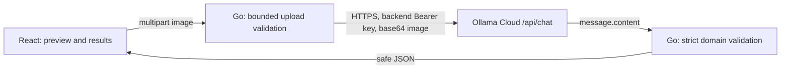

# FoodLens AI

Understand what's on your plate. A small React + TypeScript + Vite frontend and Go `net/http` backend analyze one food photo through **Ollama Cloud**. Food identification and nutrition are educational visual estimates, not measured facts or medical/dietetic advice.

## Current milestone

The source includes upload/preview/removal, server validation, authenticated cloud analysis, validated result/error handling, nutrition ranges and unknown values, serving assumptions, uncertainties, a preparation idea and copy controls. Automated verification is recorded in [docs/testing.md](docs/testing.md). No real cloud call, account entitlement, quota or live visual result has been verified in this environment.

No local Ollama inference, downloaded weights, cloud SDK, authentication for FoodLens users, database, image storage or result history is included.

## Architecture



The browser calls Go only. See [architecture](docs/architecture.md) and [API contract](docs/api-contract.md).

## Requirements and model access

- Go 1.22+, Node.js 20.19+ and npm. Go uses the standard library only.
- An Ollama account, private API key and available usage credits/model entitlement. A key does not guarantee free or unlimited inference.
- The hosted [model listing](https://ollama.com/api/tags) checked on 2026-10-27 includes **gemma4:31b** with vision support. This verifies public listing only, not your account access. Do not use the CLI alias `gemma4:cloud` or a local model identifier as an assumed API name.
- [Current pricing](https://ollama.com/pricing) describes usage-based charges and plan credits. Check your signed-in usage/billing before any real request. No credits were consumed by automated tests.
- No Ollama install, local server, GPU or model download is required.

## Secure backend setup

Create a key in [Ollama settings](https://ollama.com/settings/keys). Open the private `backend/.env` and set its **only** variable locally:

```dotenv
OLLAMA_API_KEY=replace_with_your_ollama_api_key
```

Replace the placeholder with your key in that private file; do not paste it into chat, frontend code or Git. `.env.example` contains the same single placeholder assignment. The server explicitly loads `.env` when started from the backend directory:

```bash
cd backend
go run ./cmd/server
```

Alternatively, privately export `OLLAMA_API_KEY` in the backend terminal; an exported value takes precedence over the file. The loader supports plain or quoted literal values and comments, performs no shell expansion, and rejects other settings without printing their values.

All other application settings are fixed in Go: server `127.0.0.1:8080`, cloud API `https://ollama.com/api`, default vision model `gemma4:31b`, and inference timeout 120 seconds. Old address/model/timeout environment variables are ignored; remove them from private files. Before each analysis, the backend checks the hosted listing for the default model's vision and completion capabilities. If it is unavailable, inference stops safely without switching models. No additional application setup variables are needed. A hosting platform may supply PORT automatically; the server validates it and binds publicly only when it is supplied. Keep it out of the key-only .env.

Model discovery does **not** detect free eligibility or account balance. Your Ollama account controls whether requests are covered by an allowance or billed. FoodLens makes no automatic model fallback or retry after quota/payment failures. No live account access or free inference has been verified here.

Health check:

```bash
curl http://127.0.0.1:8080/api/health
# {"status":"ok"}
```

Health means the Go process is responding, not that cloud credentials or quota work. Startup validates configuration without making a paid request. Missing credentials/configuration stop startup with a safe message.

## Frontend setup

In a separate terminal:

```bash
cd frontend
npm ci
npm run dev
```

Open the URL Vite prints, normally `http://127.0.0.1:5173`. The development proxy forwards `/api` to `http://127.0.0.1:8080`; the backend address is fixed in Go. Select a JPEG, PNG or WebP file up to 5 MiB, inspect the preview and choose **Analyze photo**. Inspect the ranges, assumptions and uncertainty; copy the result if useful. Unknown nutrients display as **Unknown**. Unclear/non-food photos receive a request for a clearer photo without invented preparation or nutrition advice.

Inference defaults to a 120-second deadline. Overall server timeout is 135 seconds, write deadline 200 seconds and browser abort 210 seconds. No automatic retries or repair calls are made. Errors allow a deliberate manual retry.

## Verification and build

```bash
cd backend
gofmt -w .
go test ./...
go vet ./...
```

```bash
cd frontend
npm run lint
npm test
npm run build
```

The lint script checks TypeScript; ESLint is not configured. Tests use synthetic fixtures and mock cloud transport, not real credentials. `npm run preview` inspects the static build and does not proxy the API. Go can serve the built frontend and API on the same origin. Follow the [native Render deployment guide](docs/deployment.md) for one hosted Go service. Hosting uses direct build/start commands; no Docker or GitHub Actions workflow is required. Actual Render deployment remains unverified.

## Privacy and limitations

Submitting transmits your image to an external hosted AI service, Ollama Cloud. This app does not persist images or results; provider processing and retention policies still apply. Avoid sensitive or identifiable photos. See [Ollama cloud documentation](https://docs.ollama.com/cloud) and provider privacy terms. Do not describe inference as local or suitable for regulated workloads.

JPEG/PNG/WebP checks inspect content signatures, not complete decoding. Visual identification can be wrong; hidden ingredients, oils, sauces, recipe variations and portion size cannot be established reliably from one photo. Never rely on the result for allergens or medical decisions.

Ollama currently documents [cloud structured outputs as unsupported](https://docs.ollama.com/capabilities/structured-outputs). FoodLens requests JSON through the prompt, omits unsupported format enforcement and strictly validates the response. Invalid output fails safely rather than being fabricated or repaired through extra cloud calls.

## Project documentation

See the [prompt and feature history](docs/prompt-history.md) for the chronological request timeline, feature outcomes, provider changes and versioned runtime prompts.

The `docs/` directory contains the API contract, architecture, model settings, exact prompt history, context handoff, actual challenges/test records, security review, workflow, weekly updates and demo/presentation outlines. Templates or old records are explicitly historical; they do not constitute live demo evidence.

## Troubleshooting AI_INVALID_RESPONSE

Restart Go after code updates. Valid JSON enclosed in one Markdown fence is now accepted, and the model prompt includes full analyzed/non-food JSON templates. If the response still fails, check the Go terminal for `foodlens_ai_response_rejected` and its `reason`/`field`. Share only that controlled diagnostic line, never your key, image bytes or a complete model response. For example, `output_truncated` identifies an unfinished answer; `missing_field` identifies schema drift. The public message stays safe and generic. No live response was reproduced during this fix, so these changes do not establish the cause of a previous individual request.

## Capture a food photo

Choose **Take a photo**, allow browser camera access, wait for the live preview, then choose **Capture photo**. You can cancel the camera or remove the captured image. Capture creates an in-memory JPEG (maximum long edge 1600 pixels) and applies the same 5 MiB validation as file selection. Nothing is sent to Go/Ollama until you choose **Analyze photo**.

Live camera access needs a supported browser, permission and HTTPS or localhost. Unsupported browsers, denied access and missing devices show errors while retaining the existing file picker. Camera tracks stop on cancel, capture, analysis or unmount; late permission responses are stopped after cancellation. Real hardware/mobile behaviour has not been manually verified in this environment.

## One-service hosting

Keep frontend and backend in this GitHub repository and run them together on Render's native Go runtime. Render builds React with npm, compiles Go and starts the Go server, which serves both the frontend and API. No separate frontend API URL or CORS setup is needed. Set only OLLAMA_API_KEY privately in Render and deploy manually with Auto-Deploy Off. See [deployment instructions](docs/deployment.md).

## Nutrition goals and comparison indicators

After analyzing a food photo, choose **Weight loss**, **Maintain weight** (default) or **Weight gain** using the compact **Your goal** tab-style buttons. These are a native single-choice radio group: Tab focuses the selected goal and arrow keys move/select within the group. References and nutrition lines update immediately using the illustrative per-meal presets below. No manual number entry or Apply button is needed. These are comparison examples, not personalised dietary advice or weight-change guarantees.

Estimated ranges, midpoints, serving assumption and confidence stay unchanged. A range entirely above the reference shows **Above goal reference**; entirely below shows **Below goal reference**; overlapping or equal boundaries show **Includes goal reference**. For example, Weight gain with 800–950 kcal is above its 750 kcal reference. Unknown nutrients have no comparison; non-food results have no selector or nutrition advice. Scales stay fixed across goal changes for each result, so only reference markers move.

The analyzer remembers its selected goal across navigation and new results until refresh, which resets it to Maintain weight. The landing sample has its own independent selection. Copy includes the selected goal, all illustrative references, comparisons and disclaimer. No goal selection is persisted or sent to Go/Ollama.

### Interactive sample goal presets

In the landing sample, use the same tab-style radio controls under **Explore a demo goal** to choose Weight loss, Maintain weight (default) or Weight gain. Reference markers, labels and coloured borders update immediately. Both sections support Tab entry and arrow-key selection; the sample has no hidden dropdown. Estimated ranges, midpoints and scale positions stay fixed; only the comparisons and reference markers change. No photo, key or model call is needed. The sample selection resets when its component is reopened; it never changes the analyzer selection.

| Demo goal (per meal) | Calories | Protein | Carbohydrates | Fat |
|---|---:|---:|---:|---:|
| Weight loss | 450 kcal | 20 g | 55 g | 15 g |
| Maintain weight | 600 kcal | 25 g | 75 g | 20 g |
| Weight gain | 750 kcal | 30 g | 95 g | 25 g |

These presets are application examples, not nutritional prescriptions or promises of weight change. “Below / Includes / Above demo reference” compares the whole estimated interval, including equality, rather than judging meal health. The analyzer reuses these same presets with “goal reference” labels and an independent selection.

The [FDA explains that calorie needs vary with personal characteristics and activity](https://www.fda.gov/food/nutrition-facts-label/how-understand-and-use-nutrition-facts-label), while the [NIDDK Body Weight Planner describes personalised weight planning](https://www.niddk.nih.gov/health-information/weight-management/body-weight-planner). These sources inform the distinction between a demo and personal advice; they do **not** provide or endorse the preset numbers above. No personalised calculation was added.

### Full-card nutrition themes

Both `#/analyze` and `#sample-result` use full-card themes: pale amber/dark brown for Above reference, pale blue/dark blue for Below, pale green/dark green for Includes, and light grey/dark grey for Unknown. Headings, values, midpoint/reference text, badge, graph track, interval, markers and legend use coordinated colours. Borders remain subtle and consistently 2px wide.

Goal selection updates the theme immediately using the existing whole-range comparison, including equality. Explicit status badges remain so meaning never depends on colour alone. Presets, estimates, midpoints, graph scales and disclaimers remain unchanged; colours are comparisons to illustrative references, not meal-health ratings. Source-palette checks passed the project's 4.5:1 normal-text and 3:1 meaningful graph-indicator contrast targets. Manual browser/mobile review is left to the user; automated checks do not certify rendered appearance.

### Nutrition-colour legend

A compact **What the colours mean** legend appears immediately above the cards in both `/#/analyze` and `/#sample-result`. Four swatches are paired with **Above reference**, **Below reference**, **Range includes reference** and **Estimate unknown**; colour names are omitted from the UI. The note explains that colours compare estimated ranges with the selected reference, not meal health. Items wrap on narrow screens. Non-food results have no nutrition cards or legend.

### Pinned analysis summary

The results panel keeps **Your analysis**, identification confidence, dish name and copy action above a separate scrolling details area. Ingredients, nutrition and preparation scroll beneath it. Desktop uses the existing bounded workspace; below 860px, completed results are capped at 85dvh so the same panel behaviour applies without a viewport-fixed overlay. The panel itself remains in normal page flow. Non-food results use the same summary/detail separation, and clipboard fallback text remains available in a bounded area. Browser/mobile verification is left to the user.
