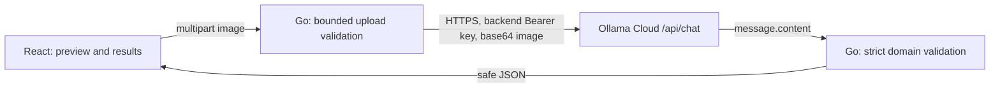

# FoodLens AI

Understand what's on your plate. A small React + TypeScript + Vite frontend and Go `net/http` backend analyze one food photo through **Ollama Cloud**. Food identification and nutrition are educational visual estimates, not measured facts or medical/dietetic advice.

## Current milestone

The source includes upload/preview/removal, server validation, authenticated cloud analysis, validated result/error handling, nutrition ranges and unknown values, serving assumptions, uncertainties, a preparation idea and copy controls. Automated verification is recorded in [docs/testing.md](docs/testing.md). No real cloud call, account entitlement, quota or live visual result has been verified in this environment.

No local Ollama inference, downloaded weights, cloud SDK, authentication for FoodLens users, database, image storage or result history is included.

## Architecture



The browser calls Go only. See [architecture](docs/architecture.md) and [API contract](docs/api-contract.md).

## Requirements and model access

- Go 1.22+, Node.js 20.19+ and npm. Go uses the standard library only.
- An Ollama account, private API key and available usage credits/model entitlement. A key does not guarantee free or unlimited inference.
- The hosted [model listing](https://ollama.com/api/tags) checked on 2026-10-27 includes **gemma4:31b** with vision support. This verifies public listing only, not your account access. Do not use the CLI alias `gemma4:cloud` or a local model identifier as an assumed API name.
- [Current pricing](https://ollama.com/pricing) describes usage-based charges and plan credits. Check your signed-in usage/billing before any real request. No credits were consumed by automated tests.
- No Ollama install, local server, GPU or model download is required.

## Secure backend setup

Create a key in [Ollama settings](https://ollama.com/settings/keys). In a **bash** terminal:

```bash
# Read privately; do not put a real key in source or a shell command/history.
read -r -s -p "Ollama API key: " OLLAMA_API_KEY
export OLLAMA_API_KEY
export OLLAMA_BASE_URL=https://ollama.com/api
export OLLAMA_MODEL=gemma4:31b
export OLLAMA_TIMEOUT_SECONDS=120
export SERVER_ADDR=127.0.0.1:8080
cd backend
go run ./cmd/server
```

`.env.example` contains placeholders only. **Go does not automatically load .env files.** Replace example values and export variables in the backend terminal; do not export literal placeholders. Key and model are required. Address/base URL/timeout default to the values above. Timeout accepts 1–180 seconds. Only the hosted HTTPS Ollama URL is allowed. Never put the key in React or `VITE_*` variables; never print it or run credential-bearing commands with shell tracing.

Health check:

```bash
curl http://127.0.0.1:8080/api/health
# {"status":"ok"}
```

Health means the Go process is responding, not that cloud credentials or quota work. Startup validates configuration without making a paid request. Missing credentials/configuration stop startup with a safe message.

## Frontend setup

In a separate terminal:

```bash
cd frontend
npm ci
npm run dev
```

Open the URL Vite prints, normally `http://127.0.0.1:5173`. The development proxy forwards `/api` to `http://127.0.0.1:8080`; update it if you deliberately change the backend port. Select a JPEG, PNG or WebP file up to 5 MiB, inspect the preview and choose **Analyze photo**. Inspect the ranges, assumptions and uncertainty; copy the result if useful. Unknown nutrients display as **Unknown**. Unclear/non-food photos receive a request for a clearer photo without invented preparation or nutrition advice.

Inference defaults to a 120-second deadline. Overall server timeout is provider timeout + 15 seconds, write deadline 200 seconds and browser abort 210 seconds. No automatic retries or repair calls are made. Errors allow a deliberate manual retry.

## Verification and build

```bash
cd backend
gofmt -w .
go test ./...
go vet ./...
```

```bash
cd frontend
npm run lint
npm test
npm run build
```

The lint script checks TypeScript; ESLint is not configured. Tests use synthetic fixtures and mock cloud transport, not real credentials. `npm run preview` inspects the static build and does not proxy the API. Production hosting must serve the build and route `/api` to Go on the same origin; deployment is deferred.

## Privacy and limitations

Submitting transmits your image to an external hosted AI service, Ollama Cloud. This app does not persist images or results; provider processing and retention policies still apply. Avoid sensitive or identifiable photos. See [Ollama cloud documentation](https://docs.ollama.com/cloud) and provider privacy terms. Do not describe inference as local or suitable for regulated workloads.

JPEG/PNG/WebP checks inspect content signatures, not complete decoding. Visual identification can be wrong; hidden ingredients, oils, sauces, recipe variations and portion size cannot be established reliably from one photo. Never rely on the result for allergens or medical decisions.

Ollama currently documents [cloud structured outputs as unsupported](https://docs.ollama.com/capabilities/structured-outputs). FoodLens requests JSON through the prompt, omits unsupported format enforcement and strictly validates the response. Invalid output fails safely rather than being fabricated or repaired through extra cloud calls.

## Project documentation

The `docs/` directory contains the API contract, architecture, model settings, exact prompt history, context handoff, actual challenges/test records, security review, workflow, weekly updates and demo/presentation outlines. Templates or old records are explicitly historical; they do not constitute live demo evidence.
