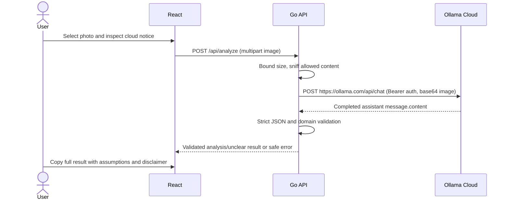

# Architecture — Ollama Cloud

React owns selection, in-memory preview, validation feedback and results. Go owns authoritative upload checks, cloud authentication, timeouts and domain validation. The browser never contacts Ollama directly.

## Boundaries

- `validation`: existing inclusive 5 MiB signature allowlist; multipart body adds 64 KiB framing. Memory-only stream reading, no temporary files. Complete decoding is not performed.
- `config`: reads only OLLAMA_API_KEY; loads the private backend .env explicitly with exported-key precedence. Server address, hosted HTTPS URL, default model and 120-second inference timeout are fixed Go defaults.
- `ai`: mockable standard-library HTTP adapter; explicit Bearer header, two messages, base64 images, stream false, 4096 generated-token limit. No automatic retries, redirects or unsupported cloud format enforcement.
- `food`: strict required/unknown-field checks, non-negative finite ordered ranges, explicit unknowns, bounded strings/arrays and status consistency. Final disclaimer is owned by the application.
- `api`: injects analyzer; health stays process-only. Errors are sanitized JSON, including overall timeout responses.
- React `services/api.ts`: only application API calls; validates result shape and handles unreadable proxy errors. Small result/copy components render plain text, never HTML from the model.

## Deadlines and memory

Inference deadline is fixed at 120 seconds; connection/TLS deadlines 10 seconds. Processing deadline is 135 seconds, server write deadline 200 seconds, browser deadline 210 seconds. Existing 5-second header, 15-second read and 60-second idle limits remain. Cancellation propagates to the HTTP request.

Cloud response envelope is bounded at 256 KiB and extracted JSON at 32 KiB. Upload/base64/JSON allocations remain bounded by the image limit; no image/result persistence or payload logging occurs. Preview URLs are revoked on replacement/removal/unmount. Copy contains text only.

The app uses no SDK, database, local Ollama server, history, authentication for users or orchestration. Health does not prove provider readiness. Public model listing and account entitlement are separate checks. Structural validation cannot prove visual truthfulness or detect every unsupported health claim; the prompt and permanent uncertainty disclaimer remain necessary.

## Key-only configuration and model discovery

The Go server starts from `backend/`, loads only OLLAMA_API_KEY from `.env` (or an existing exported key), then uses fixed configuration constants. Old environment settings cannot change the cloud destination, model or deadlines. Unsupported assignments in the private file are rejected; secret values are never included in errors.

For each analysis, a bounded authenticated GET /api/tags runs inside the same 120-second deadline before inference. Only the fixed default gemma4:31b is eligible and it must advertise vision and completion. Failure returns a safe error; no alternative model, retry or paid probing call is made. The listing is capability metadata, not proof of free usage or account entitlement.
