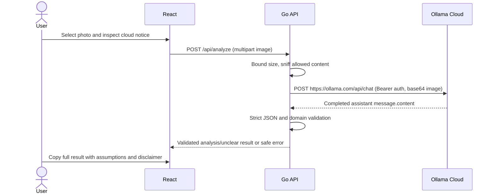

# Architecture — Ollama Cloud

React owns selection, in-memory preview, validation feedback and results. Go owns authoritative upload checks, cloud authentication, timeouts and domain validation. The browser never contacts Ollama directly.

## Boundaries

- `validation`: existing inclusive 5 MiB signature allowlist; multipart body adds 64 KiB framing. Memory-only stream reading, no temporary files. Complete decoding is not performed.
- `config`: reads only OLLAMA_API_KEY; loads the private backend .env explicitly with exported-key precedence. Server address, hosted HTTPS URL, default model and 120-second inference timeout are fixed Go defaults.
- `ai`: mockable standard-library HTTP adapter; explicit Bearer header, two messages, base64 images, stream false, 4096 generated-token limit. No automatic retries, redirects or unsupported cloud format enforcement.
- `food`: strict required/unknown-field checks, non-negative finite ordered ranges, explicit unknowns, bounded strings/arrays and status consistency. Final disclaimer is owned by the application.
- `api`: injects analyzer; health stays process-only. Errors are sanitized JSON, including overall timeout responses.
- React `services/api.ts`: only application API calls; validates result shape and handles unreadable proxy errors. Small result/copy components render plain text, never HTML from the model.

## Deadlines and memory

Inference deadline is fixed at 120 seconds; connection/TLS deadlines 10 seconds. Processing deadline is 135 seconds, server write deadline 200 seconds, browser deadline 210 seconds. Existing 5-second header, 15-second read and 60-second idle limits remain. Cancellation propagates to the HTTP request.

Cloud response envelope is bounded at 256 KiB and extracted JSON at 32 KiB. Upload/base64/JSON allocations remain bounded by the image limit; no image/result persistence or payload logging occurs. Preview URLs are revoked on replacement/removal/unmount. Copy contains text only.

The app uses no SDK, database, local Ollama server, history, authentication for users or orchestration. Health does not prove provider readiness. Public model listing and account entitlement are separate checks. Structural validation cannot prove visual truthfulness or detect every unsupported health claim; the prompt and permanent uncertainty disclaimer remain necessary.

## Key-only configuration and model discovery

The Go server starts from `backend/`, loads only OLLAMA_API_KEY from `.env` (or an existing exported key), then uses fixed configuration constants. Old environment settings cannot change the cloud destination, model or deadlines. Unsupported assignments in the private file are rejected; secret values are never included in errors.

For each analysis, a bounded authenticated GET /api/tags runs inside the same 120-second deadline before inference. Only the fixed default gemma4:31b is eligible and it must advertise vision and completion. Failure returns a safe error; no alternative model, retry or paid probing call is made. The listing is capability metadata, not proof of free usage or account entitlement.

## Browser camera capture

A small CameraCapture component uses getUserMedia with video only and a preferred rear-facing camera. Capture draws a scaled frame to an in-memory canvas, encodes JPEG and passes a File through ImageUploader's existing type/size validation and object-URL preview. The existing multipart API and analysis submission are unchanged. Camera streams are stopped on capture/cancel/unmount or analysis; stale permission/capture callbacks cannot revive a cancelled session. Permission/support errors retain the file-picker alternative. No photo is automatically uploaded or persisted.

## Single-service deployment — native runtime

Render's native Go runtime builds frontend/dist with npm and compiles the Go server. The repository-root build command has access to both subdirectories, and the start command changes into backend so `../frontend/dist` resolves correctly. Go serves existing built assets only; API routes retain JSON handling. There is no container or automated GitHub Actions pipeline in the current setup.

Platform PORT is validated separately from key-only application configuration for public binding; no PORT means loopback-only local default. The key remains in the backend runtime only. Releases are manual with Auto-Deploy Off after local frontend/Go checks. Existing Docker/CI records are historical; see deployment.md for the active settings. No actual native Render deployment or live provider test has been verified.

## Frontend nutrition comparisons and goals — 2026-10-27

The analyzer and sample share `frontend/src/utils/goalPresets.ts`: three illustrative profiles, a goal type/list, maximum reference values and disclosure text. NutritionGoalsProvider retains only the analyzer's selected goal above routes, default Maintain weight; it derives references from that selection. NutritionGoals delegates to a shared GoalTabs component containing a fieldset/legend and native radio inputs styled as segmented tabs, with an optional accessible announcement. Browser radio behaviour supplies Tab entry and arrow-key navigation; each group uses a unique name. Manual-entry profiles, drafts, validation and Apply controls have been removed. Navigation and new results preserve the analyzer selection until refresh/unmount. No browser storage or backend transmission occurs.

SampleMealShowcase keeps a separate local selection and renders the same GoalTabs component; reopening resets it. The old tab buttons and hidden select were removed. Sample nutrition fixtures stay in `frontend/src/utils/sampleGoals.ts`. Both views pass the shared maximum reference values to NutritionCards. Its scale base is the maximum of all goal references for that nutrient, the current range maximum and 1, followed by 15% headroom; interval/midpoint positions stay fixed across selections. Copy uses the same whole-range comparison utility, includes all selected references even for unknown nutrients, and retains the disclaimer. Null estimates omit comparison markers; non-food outcomes omit goal/nutrition UI. Model prompts, response fields, serving assumptions and confidence are unchanged.

## Historical border-only presentation — 2026-10-27

The analyzer reuses the sample's segmented visual styles, with checked-state styling and focus-within outlines for its native radio group. Sample state remains independent; its controls now use the shared native-radio component too. NutritionCards derives its above/below/includes/unknown class from the same comparison used by its text badge. CSS supplies a constant 2px border (amber #77501c, blue #365778, green #365e46, neutral #bdc7bd), including neutral width before a comparison is known. Backgrounds, data, markers, scale calculation and copied text are unchanged. No API/model work or additional network request is involved.

## Sample/analyzer control parity — 2026-10-27

GoalTabs is controlled through a label, value and onChange callback, with a unique radio-group name per instance. NutritionGoals supplies analyzer context state; SampleMealShowcase supplies local state. The sample retains its visible demo-status line/disclaimer, while the analyzer supplies a screen-reader announcement. Both use the same selected/focus styles and NutritionCards status themes. Obsolete hidden-select and button-tab CSS was removed. A socket-denied attempt to inspect port 5175 did not establish any live-browser or stale-cache cause.

## Full-card status themes — 2026-10-27

NutritionCards already supplies above/below/includes/unknown classes. Shared CSS now defines theme variables for card background, primary/secondary text, subtle border, badge background, graph track/interval and markers. Above uses pale amber/dark brown, below pale blue/dark blue, includes pale green/dark green; the base/unknown palette is light grey/dark grey. Descendants consume these variables rather than the earlier fixed green text/graph colours. Badges retain a white surface with theme-coloured text; circle markers use a white ring and reference ticks have a card-coloured halo. Borders stay 2px to avoid layout shifts. Both routes inherit this presentation without new React state, API fields, provider calls or changed comparison logic.

Source-colour contrast validation passed for normal text/badges (at least 4.5:1) and checked graph-indicator pairs (at least 3:1). It does not replace browser inspection. The user will perform manual browser/mobile checks; no successful rendered validation is claimed.

## Shared colour legend — 2026-10-27

NutritionCards renders NutritionColourLegend immediately before its grid, so analyzer and sample share one implementation. A labelled complementary region contains four text-labelled items and aria-hidden decorative swatches, followed by a non-health-rating explanation. Swatches and cards consume the same CSS palette variables; default variables now live on both classes. The UI omits colour names at the user's request. Flex wrapping supports narrow layouts. Non-food handling bypasses NutritionCards and therefore omits the legend. No comparison/state/API/provider changes. Legend text has explicit inherited styling to avoid the broader analyzer paragraph rules overriding it.

## Pinned results summary — 2026-10-27

AnalyzerWorkspace retains the section heading outside AnalysisResults and adds has-analysis for completed results. AnalysisResults separates analysis-summary (confidence/photo-check, copy action, dish/explanation heading) from analysis-scroll-body (details), for both analyzed and unclear results. Flex sizing/min-height:0 moves overflow from the outer results card into the detail body. The heading/summary do not scroll with those details; no viewport-fixed positioning or measured sticky offsets are needed. Mobile completed-result panels are capped at 85dvh below 860px; desktop retains existing workspace bounds. Copy fallback has a 25vh scrolling cap. API fields, model behaviour and copy content are unchanged. Automated structure/clipboard tests passed; no manual browser validation performed.
